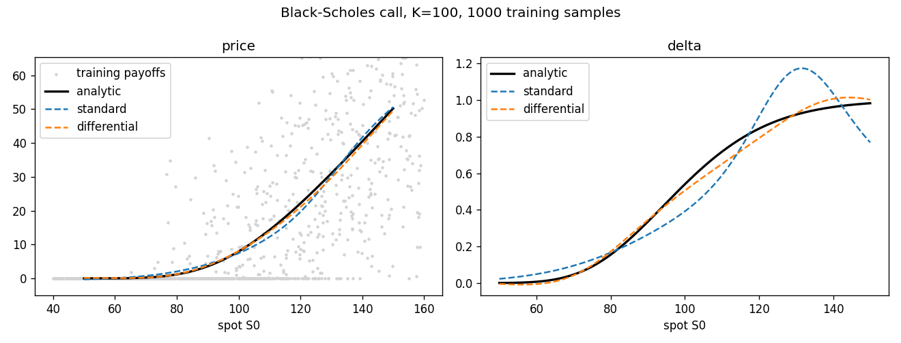

# diffml-rates

Differential machine learning for rates derivatives, in PyTorch. Based on Huge and Savine (2020).

## Summary

I was looking for something to implement to learn PyTorch, and the Huge and Savine paper was a good fit: autograd is the whole trick. So I wanted to see if their idea holds up on rates: train a network on simulated payoffs plus their pathwise derivatives, and check whether the Greeks come out better than with payoffs alone.

I built up to it in four steps: a Black-Scholes call, a Bachelier basket (1, 7 and 20 assets), a Bachelier swaption, and finally a Hull-White swaption where the inputs are 10 zero-rate pillars and the Greeks are the pillar DV01s.

It works best on the last one. With 64k samples the DV01 error is 0.024bp, against 1.32bp for the same network trained without derivatives, which gets the parallel risk about right but puts it on the wrong pillars. Prices are less reliable than Greeks, and the vega labels are too noisy to help much.

Next I'd average over a few seeds, try antithetic paths, and move to a product that actually needs Monte Carlo to price, like a Bermudan swaption.

## How it works

The usual way to learn a pricer by simulation: pick an input x (a spot, or a curve), simulate one path, record the discounted payoff y, and fit a network to lots of (x, y) pairs. A single payoff is a very noisy estimate of the price, so you need a lot of samples.

Huge and Savine's trick is to also record dy/dx along the same path, which is basically free with autograd or a formula. The network is then trained on both:

```
loss = MSE(values) + lambda * MSE(differentials)
```

where the network's own differentials come from autograd. Each sample now tells the network the slope of the price as well as its level.

The setup is the same everywhere: 4 hidden layers of 20 softplus units, inputs and outputs standardised, each differential column scaled to unit size, lambda = 1, and Adam for up to 4,000 steps with early stopping on 20% of the data. The baseline is the same network trained on payoffs only. Calls and payers use w = 1, puts and receivers w = -1; the results below are calls and payers.

Why bother: a risk engine needs prices and sensitivities over thousands of scenarios. Bump and reprice costs one revaluation per sensitivity, while a trained network gives the price and all first-order Greeks in one pass. That's only useful if the Greeks are accurate, which is where the derivative labels come in.

## Results

Errors are RMSE against closed forms on a test set. Each cell is a single run, so expect some noise. `python experiments/run_all.py` regenerates everything.

### Hull-White swaption (M4)

5y x 10y payer swaption, at the money (4.11%), annual fixed leg. Hull-White with a = 3% and sigma = 1%. The inputs are 10 zero rates from 1y to 30y, made by shocking a base curve (parallel, slope, curvature, plus a bit of noise). The short rate at expiry is drawn exactly, the swap is priced with Hull-White bond prices, and autograd gives the pillar DV01s.

The benchmark is Jamshidian for the price and 1bp bumps for the DV01s. I checked it against a 2M path Monte Carlo first, and it agrees to within about one standard error ([m4_validation.csv](results/m4_validation.csv)).

Everything is in bp of notional, with DV01 per 1bp on one pillar. For scale, the price on the base curve is 510bp.

| Training samples | Price, standard | Price, differential | DV01, standard | DV01, differential |
|---:|---:|---:|---:|---:|
| 1,000 | 110.4 | 42.7 | 2.13 | 0.288 |
| 4,000 | 59.3 | 39.1 | 1.40 | 0.112 |
| 16,000 | 21.8 | 12.6 | 1.22 | 0.037 |
| 64,000 | 19.9 | 3.6 | 1.32 | 0.024 |


The standard network stalls at about 1.3bp of DV01 error however much data it gets. The curves mostly move in parallel (the 5y and 15y pillars are 0.94 correlated), so from payoffs alone it can't tell which pillar the risk sits on. It gets the parallel DV01 about right (0.22bp error at 64k, for a typical size of 2.9) but smears it across pillars, including ones the trade doesn't depend on. The derivative labels give each pillar directly, so the twin network gets the split right.

Only the 5y, 7y, 10y and 15y pillars carry any DV01 here, since expiry sits on the 5y pillar and the swap ends at 15y. The twin network puts close to zero on the rest ([per pillar errors](results/m4_dv01_rmse_by_pillar.csv)).

On speed, price plus 10 DV01s takes 2,630 microseconds per curve with bump and reprice and 0.66 through the network (batch of 500, not counting about 3 seconds of training). To be fair, Jamshidian is already cheap. The gain would matter a lot more for something priced by Monte Carlo.

### Black-Scholes call (M1)

K = 100, vol 20%, 1 year, r = 0. Trained on spots from 40 to 160, tested on 50 to 150.

| Training samples | Price, standard | Price, differential | Delta, standard | Delta, differential |
|---:|---:|---:|---:|---:|
| 1,000 | 1.190 | 0.663 | 0.1158 | 0.0336 |
| 4,000 | 0.580 | 0.499 | 0.0326 | 0.0198 |
| 16,000 | 0.237 | 0.683 | 0.0157 | 0.0160 |
| 64,000 | 0.390 | 0.360 | 0.0132 | 0.0095 |



At 1,000 samples the twin network's delta is about as good as the baseline's at 4,000. With a single input the gap closes as data grows. The twin network's price at 16k and 64k is off by a roughly constant amount: the derivatives say nothing about the level, so the level only comes from the noisy payoffs.

### Bachelier basket (M2)

A call on a basket of n correlated Bachelier assets, with random vols, correlations and weights. Delta error is pooled over the assets, and per-asset deltas get smaller as n grows, so it's the ratios that compare across rows, not the raw numbers.

| Assets | Delta at 1k, standard | Delta at 1k, differential | Ratio | Delta at 64k, standard | Delta at 64k, differential | Ratio |
|---:|---:|---:|---:|---:|---:|---:|
| 1 | 0.1169 | 0.0219 | 5.3 | 0.0204 | 0.0105 | 1.9 |
| 7 | 0.2720 | 0.0090 | 30.1 | 0.0106 | 0.0012 | 8.7 |
| 20 | 0.0192 | 0.0038 | 5.1 | 0.0132 | 0.0007 | 19.5 |

At 64k samples the ratio goes 1.9, 8.7, 19.5 as the number of assets goes up, which is the paper's point. At 1k it's messier, mostly because the 7-asset baseline had a bad run. The true price only depends on the basket value, and the twin network picks that up from 1,000 samples in 20 dimensions:


[m2_rmse.csv](results/m2_rmse.csv) has every size.

### Bachelier swaption (M3)

1y x 5y payer, K = 3%, with the annuity fixed at 4.4386 (flat 3% curve). The inputs are the forward and the normal vol. Delta is per unit of rate (max 4.44) and vega per unit of vol (max about 1.8).

| Training samples | Price (bp), standard | Price (bp), differential | Delta, standard | Delta, differential | Vega, standard | Vega, differential |
|---:|---:|---:|---:|---:|---:|---:|
| 1,000 | 22.5 | 26.9 | 0.286 | 0.218 | 1.342 | 0.317 |
| 4,000 | 20.5 | 6.4 | 0.425 | 0.079 | 0.468 | 0.168 |
| 16,000 | 8.2 | 7.9 | 0.063 | 0.064 | 0.190 | 0.103 |
| 64,000 | 7.2 | 1.8 | 0.103 | 0.031 | 0.217 | 0.061 |


This is the weakest of the four. The twin network wins on vega and at 4k and 64k, but loses on price at 1k and ties on delta at 16k. Part of the reason is the vega label, A · 1{in the money} · √T · Z, whose noise is about 3.1 times the true vega (0.48 for delta), and the network ends up fitting some of that noise. Over five seeds at 1k the delta errors average 1.10 for the baseline and 0.24 for the twin network ([robustness_checks.csv](results/robustness_checks.csv)), so the 1k row in the table undersells it.

## Compared with the paper

The same as the paper: network size and activation, the loss (mine is the paper's up to a constant factor), lambda = 1, the normalisation, pathwise derivatives, early stopping, and the 7-asset basket with 1k and 64k samples. M1 and M2 follow the paper's examples with my own parameters. M3 and M4 aren't in the paper.

Different: a cosine learning rate instead of one-cycle, PyTorch's default initialisation instead of Xavier-Glorot, an at-the-money basket strike instead of 110 on 100, and my own early-stopping rule (see below). I didn't use the authors' notebook, so epochs and batch sizes are my choice.

The paper says that on the 7-asset basket a twin network with 1k samples beats a normal one with 64k. Here that's roughly true for deltas and not for prices. In the main run the delta error is 0.0090 at 1k against 0.0106 at 64k, but over five seeds the 1k twin network averages 0.013, so I'd call it a draw. On price the 64k network is about twice as good (0.0014 against 0.0029).

## Limitations

- Early stopping. With 1,000 samples, 4,000 steps is about 1,000 passes over the data and both networks start fitting noise. Early stopping fixes most of that on the 7-asset basket (over five seeds the baseline goes from 0.84 to 0.088, the twin network from 0.039 to 0.013) but does nothing for M3. The validation labels are single-path payoffs, so the lowest validation loss is close to a random pick; I keep a later checkpoint unless it's worse by more than one standard error, comparing row by row. It still stops early sometimes when it shouldn't (M1 at 16k), and holding out 20% costs a bit everywhere.
- One seed per cell. Prices especially jump around between runs. The odd cells, like the M1 price at 16k or the M3 price at 1k, are this rather than a trend.
- Extrapolation isn't tested. The test sets sit inside the training range (M1 tests 50 to 150 after training on 40 to 160, M4 test curves use 80% of the training shocks). A network has no reason to behave outside that, so a risk engine would need to catch out-of-range scenarios.
- Payoffs with jumps. Pathwise derivatives cope with a kink like a call strike, but a digital or barrier jumps and the pathwise derivative misses it. Those need smoothing, which isn't covered here.
- Noisy labels. The method is only as good as the pathwise derivatives. Delta is fine, vega not so much.
- Lambda is fixed at 1 and not tuned. Inputs with all-zero derivatives (the unused pillars in M4) get weight 1 to avoid dividing by zero.
- The models are simple: a fixed annuity in M3, and in M4 one curve for discounting and projection, an annual fixed leg, constant Hull-White parameters and linear interpolation on zero rates.

## Running it

Python 3.11 or later (I used 3.12), CPU only.

```bash
pip install -e ".[dev]"
python experiments/run_all.py   # about 3 minutes, rewrites results/
pytest                          # about 30 seconds
```

Each script also runs on its own, for example `python experiments/m4_hull_white_swaption.py`, and `--quick` gives a tiny version. Seeds are fixed, so the error tables come out the same every time; only the timings change.

## Layout

```
src/diffml/
  analytics/   closed forms: Black-Scholes, Bachelier, swaption, Hull-White (Jamshidian)
  data/        simulators returning inputs, payoffs and pathwise derivatives; zero curves
  models/      network, input gradient, normalisation
  train.py     training loop with the differential loss and early stopping
  evaluate.py  error metrics, tables and plots
experiments/   one script per milestone, plus run_all.py and robustness_checks.py
results/       tables (CSV) and figures written by the experiments
tests/         closed forms, pathwise derivatives, network wiring, smoke tests
```

## Reference

Huge, B. and Savine, A. (2020). Differential machine learning. *Risk*, October 2020. Preprint: [arXiv:2005.02347](https://arxiv.org/abs/2005.02347).

I wrote the code from the paper, without using the authors' implementation.
