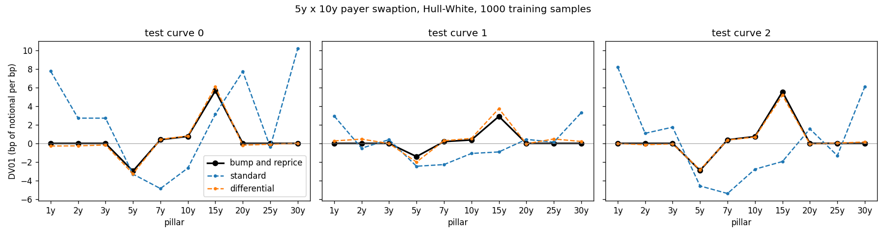
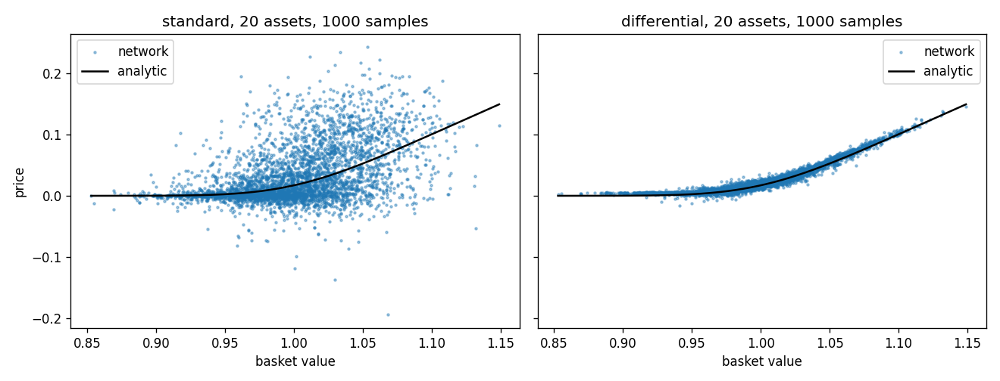
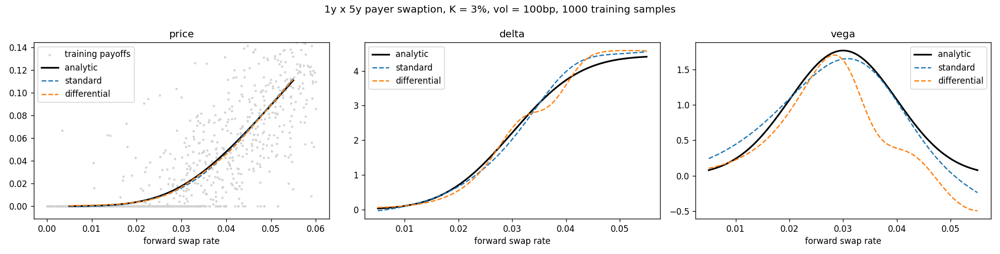

# diffml-rates

Differential machine learning for rates derivatives in PyTorch. This repo re-implements the core result of Huge and Savine (2020) and extends it to swaptions, ending with a Hull-White swaption where a small network learns the price and all ten pillar DV01s of a zero curve.

## The idea

You can learn a pricing function by simulation. Pick some inputs x (a spot, or a whole curve), simulate one path, and record the discounted payoff y. Each y is an unbiased but very noisy estimate of the price at x, so a network fitted to enough (x, y) pairs converges to the pricing function. "Enough" is usually a lot.

Huge and Savine's point is that the simulator can also return the pathwise derivative dy/dx for almost nothing extra, through automatic differentiation or a formula. That derivative is an unbiased estimate of the Greeks. Their twin network is trained on both, with loss

```
MSE(values) + lambda * MSE(differentials)
```

where the network's own differentials come from autograd. Each sample now carries one value label and one derivative label per input, so the network is told the slope of the function as well as its level. The derivative labels also regularise: a network that fits the payoffs with the wrong shape is penalised.

Every network here has 4 hidden layers of 20 softplus units. Inputs and outputs are standardised, the differentials are rescaled to match, each differential column is weighted by the inverse of its mean square, and lambda = 1. The baseline is the same network trained on values only.

## Why it matters for risk

A risk engine needs prices and sensitivities across many scenarios, for XVA or market risk. Bump and reprice costs one full revaluation per sensitivity. A trained network gives the price and every first-order sensitivity from one forward and one backward pass. That is only worth having if the sensitivities are accurate, and a network trained on values alone gives poor ones. Differential training is what makes the learned Greeks usable.

## Results

Errors are RMSE on a held-out test set against closed-form prices and Greeks. Each cell is one training run with one seed (see limitations). Every number below is regenerated by `python experiments/run_all.py`.

### M4: Hull-White swaption (main result)

A 5y x 10y payer swaption struck at the forward on the base curve (4.11%), annual fixed leg, Hull-White with mean reversion 3% and short rate vol 1%. The inputs are 10 zero rates (1y to 30y), drawn as parallel, slope and curvature shocks plus small independent noise around a base curve. The simulator draws the short rate at expiry exactly (it is Gaussian under the expiry forward measure), prices the swap with closed-form Hull-White bond prices, and autograd through the whole chain gives the pathwise pillar DV01s.

The benchmark is Jamshidian's decomposition for the price and central 1bp bumps of it for the DV01s. Before use it was checked against a 2 million path Monte Carlo on three curves: prices agree within 0.9 standard errors and DV01s within 1.1 ([m4_validation.csv](results/m4_validation.csv)).

Units are bp of notional, and DV01 is per 1bp move in one pillar. For scale, the price on the base curve is 510bp and the largest pillar DV01s are a few bp per bp.

| Training samples | Price, standard | Price, differential | DV01, standard | DV01, differential |
|---:|---:|---:|---:|---:|
| 1,000 | 270.0 | 31.4 | 6.39 | 0.418 |
| 4,000 | 53.8 | 34.9 | 1.17 | 0.109 |
| 16,000 | 21.6 | 6.7 | 1.21 | 0.037 |
| 64,000 | 21.0 | 4.4 | 1.32 | 0.026 |



The baseline's DV01 error stops improving after 4,000 samples, and more data does not fix it. The simulated curves move mostly in parallel, so the 5y and 15y pillars have a correlation of 0.94, and payoffs alone cannot say which pillar the price depends on. The baseline learns the parallel DV01 well (RMSE 0.21 at 64k samples, against a typical size of 2.9) but spreads it across the wrong pillars, including large DV01s on pillars the trade does not touch. The pathwise labels give each pillar's sensitivity directly, so the twin network gets the split right.

Only the 5y, 7y, 10y and 15y pillars have a non-zero DV01 here: expiry falls on the 5y pillar, the swap ends at 15y, and discount factors interpolate linearly on zero rates. The twin network learns DV01s close to zero on the other six ([per pillar errors](results/m4_dv01_rmse_by_pillar.csv)).

Price plus all 10 DV01s takes 2,650 microseconds per curve by bump and reprice, and 0.65 microseconds through the network on a batch of 500 curves. Training takes about 3 seconds and is not included. Jamshidian is already cheap; the case is much stronger for products that need Monte Carlo to price, where each of those 21 revaluations is expensive.

### M1: Black-Scholes call (replication)

Strike 100, vol 20%, one year, zero rates. Trained on spots from 40 to 160 and tested on 50 to 150.

| Training samples | Price, standard | Price, differential | Delta, standard | Delta, differential |
|---:|---:|---:|---:|---:|
| 1,000 | 1.313 | 0.621 | 0.1203 | 0.0374 |
| 4,000 | 0.571 | 0.332 | 0.0457 | 0.0164 |
| 16,000 | 0.428 | 0.310 | 0.0205 | 0.0130 |
| 64,000 | 0.144 | 0.059 | 0.0110 | 0.0056 |


With 1,000 samples the twin network's delta is already better than the baseline's with 4,000.

### M2: Bachelier basket (dimension)

A call on a basket of n correlated assets under Bachelier dynamics, with random vols, correlations and weights. Delta RMSE is pooled across assets. Per-asset deltas shrink as n grows, so compare the ratio across dimensions rather than the raw errors.

| Assets | Delta at 1k, standard | Delta at 1k, differential | Ratio | Delta at 64k, standard | Delta at 64k, differential | Ratio |
|---:|---:|---:|---:|---:|---:|---:|
| 1 | 0.0803 | 0.0212 | 3.8 | 0.0154 | 0.0033 | 4.6 |
| 7 | 0.7783 | 0.0395 | 19.7 | 0.0132 | 0.0010 | 13.5 |
| 20 | 0.1803 | 0.0208 | 8.7 | 0.0142 | 0.0007 | 20.1 |

At 64,000 samples the advantage grows with dimension, which is the paper's result. At 1,000 samples it does not grow cleanly, mainly because of how the baseline is trained (see limitations). The true price only depends on the basket value, and the twin network finds this from 1,000 samples in 20 dimensions:



Full table: [m2_rmse.csv](results/m2_rmse.csv).

### M3: Bachelier swaption

A 1y x 5y payer swaption, strike 3%, with the annuity held fixed at 4.4386 (a flat 3% curve). Inputs are the forward swap rate and the normal vol. Delta is per unit of rate (at most 4.44) and vega is per unit of vol (at most about 1.8).

| Training samples | Price (bp), standard | Price (bp), differential | Delta, standard | Delta, differential | Vega, standard | Vega, differential |
|---:|---:|---:|---:|---:|---:|---:|
| 1,000 | 12.8 | 8.5 | 0.173 | 0.155 | 0.405 | 0.340 |
| 4,000 | 15.9 | 5.1 | 0.337 | 0.054 | 0.449 | 0.162 |
| 16,000 | 8.1 | 6.2 | 0.069 | 0.055 | 0.172 | 0.093 |
| 64,000 | 6.1 | 4.0 | 0.065 | 0.034 | 0.208 | 0.063 |



This is the weakest of the four results. The pathwise vega, A · 1{in the money} · √T · Z, is a poor label: its noise is about 3.1 times the size of the true vega, against 0.48 for delta. The twin network partly fits that noise, which shows up as a kink in its delta and a sag in its vega above a 3.5% forward. The 1,000 sample row also understates the gap: that seed happened to give a good baseline, and over five seeds the delta errors average 0.99 for the baseline and 0.19 for the twin network ([robustness_checks.csv](results/robustness_checks.csv)).

## Limitations

**Training budget.** Every network gets a fixed 4,000 Adam steps with batches of 256. With 1,000 samples that is about 1,000 passes over the data, and both networks fit noise. Over five seeds at 1,000 samples ([robustness_checks.csv](results/robustness_checks.csv)), cutting to 1,000 steps takes the M2 7-asset delta error from 0.90 to 0.083 for the baseline and from 0.039 to 0.007 for the twin network, and on M3 from 0.99 to 0.26 and from 0.19 to 0.13. The twin network still wins with the shorter schedule, by about 12 times on M2 and 2 times on M3, but the small-sample ratios in the main tables depend on the schedule. Early stopping on a validation set would be the proper fix and is not done here.

**One seed per cell.** Single runs are noisy, especially for price. Some rows that look odd, like the twin network's M4 price error rising from 1,000 to 4,000 samples, are seed noise rather than a trend.

**Extrapolation.** Every test set sits inside the training domain. M1 trains on spots from 40 to 160 and tests on 50 to 150, and M4 test curves use 80% of the training shock sizes. Nothing here says how the networks behave outside that range, and there is no reason to expect them to behave well. A risk engine using them would need to detect scenarios outside the training domain.

**Kinks and discontinuities.** Pathwise derivatives work because these payoffs are continuous. The kink at the strike turns into a step in the derivative, which is still unbiased. A digital or barrier payoff jumps, its pathwise derivative is zero almost everywhere, and it misses the jump entirely. Those products need smoothing or a different derivative estimator, and none is tested here.

**Noisy derivative labels.** The benefit depends on how informative the pathwise derivatives are. Delta labels are good, vega labels much less so (M3).

**Choice of lambda.** Lambda is fixed at 1 throughout, with each differential column scaled to unit mean square. It is not tuned. Columns where every derivative is zero, such as the unused pillars in M4, get a weight of 1 instead of a division by zero.

**Simplified models.** M3 holds the annuity fixed. M4 uses one curve for discounting and projection, an annual fixed leg, constant Hull-White parameters, and linear interpolation on zero rates.

## Reproducing

Python 3.11 or later (tested on 3.12), CPU only.

```bash
pip install -e ".[dev]"
python experiments/run_all.py   # about 3 minutes, rewrites results/
pytest                          # about 20 seconds
```

Each experiment also runs on its own, for example `python experiments/m4_hull_white_swaption.py`, and takes `--quick` for a tiny version. Seeds are fixed, so reruns reproduce the error tables exactly; only the timings change.

## Layout

```
src/diffml/
  analytics/   closed forms: Black-Scholes, Bachelier, swaption, Hull-White (Jamshidian)
  data/        simulators returning inputs, payoffs and pathwise derivatives; zero curves
  models/      network, input gradient, normalisation
  train.py     training loop with the lambda-weighted differential loss
  evaluate.py  error metrics, tables and plots
experiments/   one script per milestone, plus run_all.py and robustness_checks.py
results/       tables (CSV) and figures written by the experiments
tests/         closed forms, pathwise derivatives, network wiring, smoke tests
```

## Reference

Huge, B. and Savine, A. (2020). Differential machine learning. *Risk*, October 2020. Preprint: [arXiv:2005.02347](https://arxiv.org/abs/2005.02347).

The code here is written from the paper and does not use the authors' implementation.
